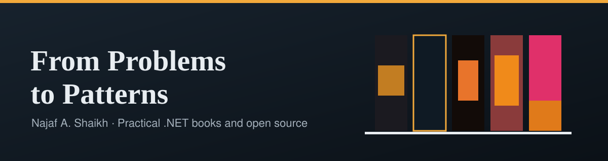
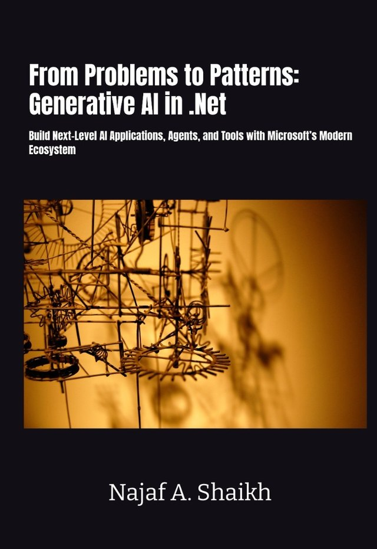
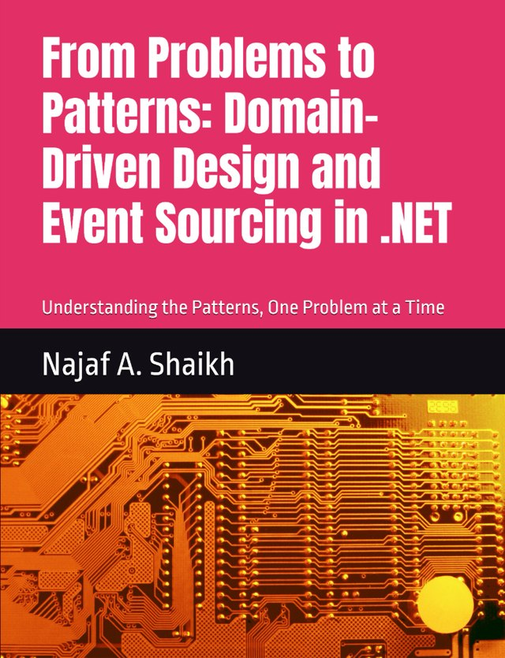

  

<h1 align="center">CØDE SHΔYK</h1>

  <strong>Practical .NET books and open source libraries</strong> 
  By <a href="https://www.linkedin.com/in/najaf-shaikh/">Najaf A. Shaikh</a>, software architect and author of <em>From Problems to Patterns</em>.

  
  
  
  

---

## 🧭 Who We Are

**CØDE SHΔYK** is the home of Najaf A. Shaikh's open source work and the companion code for his books. The books teach the patterns behind well-built .NET software, one problem at a time. The libraries are the practical building blocks that go with them.

Najaf is a software architect with a keen interest in application frameworks.

---

## 📚 Books

*From Problems to Patterns* is two separate series, the **AI Series** and the **Developer Series**. Every book has a companion repository with runnable code.

### AI Series

<table>
  <tr>
    <td width="150"></td>
    <td>
      <strong>From Problems to Patterns: Generative AI in .NET</strong> 
      <em>Build Next-Level AI Applications, Agents, and Tools with Microsoft's Modern Ecosystem</em> 
      AI Series, Book 1 
      <a href="https://www.amazon.co.uk/dp/B0H1718649">Buy on Amazon</a> · <a href="https://github.com/CodeShayk/generative-ai-dotnet-samples">Companion code</a>
    </td>
  </tr>
  <tr>
    <td width="150"></td>
    <td>
      <strong>From Problems to Patterns: Agentic UI in .NET</strong> 
      <em>Building Agentic User Interfaces with the AG-UI Protocol in .NET</em> 
      AI Series, Book 2 
      <a href="https://github.com/CodeShayk/agentic-ui-dotnet-samples">Companion code</a>
    </td>
  </tr>
  <tr>
    <td width="150"></td>
    <td>
      <strong>From Problems to Patterns: Enterprise RAG Engineering with .NET</strong> 
      <em>Building Grounded, Secure, and Production-Ready Retrieval-Augmented Generation Systems</em> 
      AI Series, Book 3 
      <a href="https://github.com/CodeShayk/enterprise-rag-dotnet-samples">Companion code</a>
    </td>
  </tr>
</table>

### Developer Series

<table>
  <tr>
    <td width="150"></td>
    <td>
      <strong>From .NET Developer to AI Engineer</strong> 
      <em>Build on the skills you already have to integrate, architect and ship reliable AI-powered applications</em> 
      <a href="https://github.com/CodeShayk/ai-engineer-dotnet-samples">Companion code</a>
    </td>
  </tr>
  <tr>
    <td width="150"></td>
    <td>
      <strong>From Problems to Patterns: Domain-Driven Design and Event Sourcing in .NET</strong> 
      <em>Understanding the Patterns, One Problem at a Time</em> 
      <a href="https://www.amazon.com/Problems-Patterns-Domain-Driven-Sourcing-Understanding-ebook/dp/B0GX32V9F1/">Buy on Amazon</a> · <a href="https://github.com/CodeShayk/dd-event-sourcing-dotnet-samples">Companion code</a>
    </td>
  </tr>
</table>

---

## 🧰 Open Source Libraries

| Library | What it does |
| --- | --- |
| [**SourceFlow.Net**](https://github.com/CodeShayk/SourceFlow.Net) | A lightweight framework for event-sourced .NET applications using domain-driven design and CQRS. Used throughout the book *Domain-Driven Design and Event Sourcing in .NET*. |
| [**Abacus Run**](https://github.com/CodeShayk/Abacus-Run) | A workflow runtime and HTTP host for durable, observable workflows, built on Microsoft Agent Framework. |
| [**ActiveForge**](https://github.com/CodeShayk/ActiveForge) | An Active Record-style ORM for .NET with providers for SQL Server, PostgreSQL and MongoDB. |
| [**DataFuse**](https://github.com/CodeShayk/DataFuse.Net) | Like GraphQL, but for your heterogeneous backends. Aggregates SQL, REST and other sources into strongly typed objects. |
| [**FeatureOne**](https://github.com/CodeShayk/FeatureOne) | Feature toggles for .NET, with SQL and file storage providers or your own storage backend. |

---

## 🤝 Contributing

Contributions are welcome, whether you are fixing a bug, improving documentation or suggesting a feature:

1. **Open an issue** on the repository to describe the change.
2. **Fork** the repository and create a feature branch.
3. **Run the tests** locally before you push.
4. **Open a pull request** that explains what changed and how you checked it.

---

  Built by <strong>Najaf A. Shaikh</strong> · <a href="https://codeshayk.github.io">codeshayk.github.io</a> · <a href="mailto:najaf.shaikh@gmail.com">najaf.shaikh@gmail.com</a>

